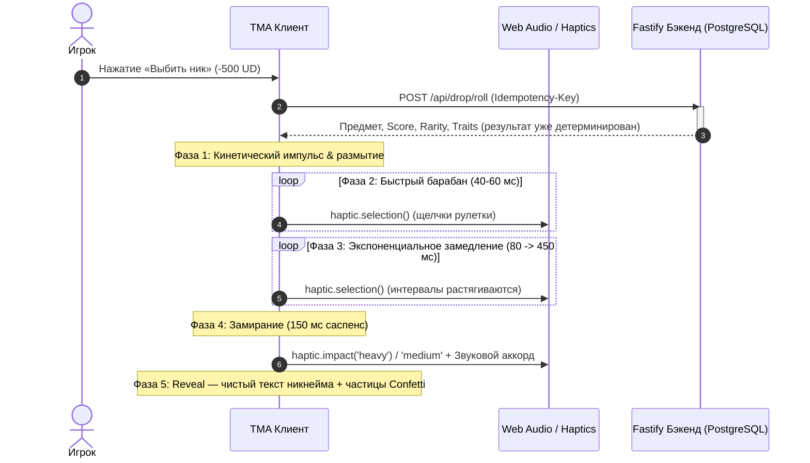
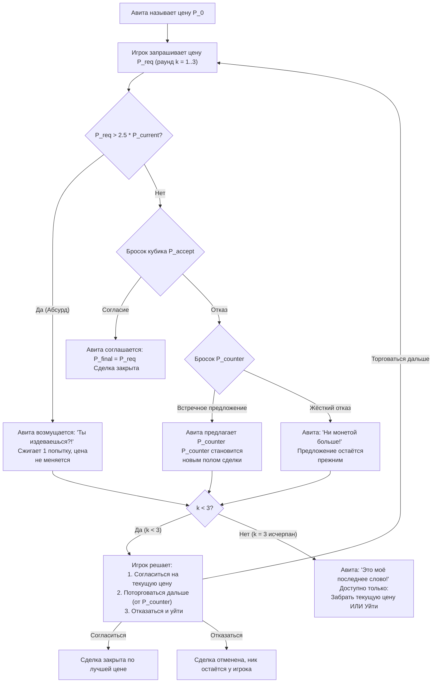

# Nickname Hunter — Улучшенная концепция: Анимация, Генерация, Массовая продажа и Живой диалог с Авитой

Данный документ развивает и дополняет мастер-спецификацию игры, фиксируя детализацию четырёх ключевых направлений развития: кинематографичную анимацию выбивания, расширенную базу и процедурную генерацию никнеймов, систему массового управления коллекцией, а также интерактивный RPG-диалог со скупщиком Авитой с математической моделью торга.

---

## 1. Кинематическая анимация выбивания никнеймов

Анимация выбивания — центральное эмоциональное событие игрового цикла. Она спроектирована как кинетический слот-барабан с нарастающим саспенсом, длящийся ровно 2.2 секунды (с возможностью мгновенного скипа в настройках).



### 5 этапов визуализации:

1. **Этап 1. Подготовка и кинетический импульс (0–150 мс):**
   - Сервер списывает 500 UD и определяет результат в транзакции до старта анимации.
   - Интерфейс плавно приглушает фоновые элементы (backdrop blur + затемнение на 15%).
   - Центральная область получает лёгкий скейл-импульс (`scale: 0.96 -> 1.0`).

2. **Этап 2. Быстрый барабан рулетки (150–900 мс):**
   - Вертикальный перебор никнеймов на максимальной скорости (шаг 45–55 мс).
   - Включается эффект Motion Blur (`filter: blur(1.5px)`), никнеймы пролетают с лёгким затуханием по краям.
   - Каждое переключение сопровождается `haptic.selection()` (эффект физического трения зубцов шестерёнки в руках).

3. **Этап 3. Экспоненциальное замедление (900–1900 мс):**
   - Частота смены имён замедляется по ступенькам: 65 мс $\rightarrow$ 90 мс $\rightarrow$ 130 мс $\rightarrow$ 190 мс $\rightarrow$ 280 мс $\rightarrow$ 420 мс.
   - Размытие motion-blur исчезает, текст становится кристально резким.
   - Тактильные щелчки становятся отчётливыми и редкими: *тр-р-р... тр... тр... тук... ТУК!*

4. **Этап 4. Саспенс-пауза и появление результата (Reveal, 1900–2200 мс):**
   - Барабан замирает на 120 мс перед финальным ником.
   - Финальный никнейм проявляется с упругой кинетикой (`scale: 1.15 -> 1.0`, длительность 300 мс).
   - **Строгий UI-инвариант:** Текст никнейма отображается **исключительно чистым текстом** (`font-mono text-3xl font-black text-white`). Вокруг букв нет рамок, капсул, плашек или карточек.
   - Эффекты редкости возникают строго вокруг или позади текста:
     - **Обычный (Common):** Плавное проявление с лёгкой вспышкой яркости букв.
     - **Необычный (Uncommon):** Изумрудное мягкое радиальное свечение на фоне.
     - **Редкий (Rare):** Короткая вспышка экрана + салют бирюзовых искр Confetti.
     - **Эпический (Epic):** Фиолетовые энергетические волны на заднем плане + 50 фиолетовых частиц Confetti.
     - **Легендарный (Legendary):** Золотой импульс + 90 золотых частиц Confetti + отдача `haptic.impact('heavy')`.
     - **Мифический (Mythic):** Двойной световой взрыв рубинового цвета, расширяющееся кольцо ударной волны на фоне, 120 частиц Confetti и максимальная тактильная отдача.

5. **Этап 5. Карточка информации и действия:**
   - Под никнеймом появляются текстовые плашки тира редкости, рейтинг `Score / 1000` и коллекционные теги (`#Genesis`, `#Shorty`, `#Symmetrical`).
   - Кнопки: «В коллекцию», «Оценить у Авиты», «Поделиться находкой».

---

## 2. Огромная база и процедурная генерация никнеймов

Каталог объединяет 8 категорий никнеймов с алгоритмической защитой от повторяемости:

| Категория | Формат | Примеры | Алгоритм генерации |
| :--- | :--- | :--- | :--- |
| **1. Буквенные комбинации** | Чистые буквы (2–12 симв.) | `@ai`, `@gg`, `@vex`, `@ziv`, `@qen`, `@zoryn`, `@velox` | Слоговый CVCV/VCV генератор + словарь 2-буквенных хэндлов |
| **2. Короткие эстетичные** | 3–4 буквы, благозвучные | `@zen`, `@sky`, `@neo`, `@fox`, `@void`, `@flux`, `@pure`, `@dark` | База премиальных коротких корней |
| **3. Tech & Cyber** | Термины технологий | `@nexus`, `@pixel`, `@cipher`, `@matrix`, `@quantum`, `@kernel` | Словарь IT, криптографии и киберпанка |
| **4. Буквенные моно-повторы** | Одинаковые буквы (2–6) | `@aa`, `@xxx`, `@vvv`, `@zzzz`, `@qqqq` | Рандомизация алфавита с повторением символа |
| **5. Симметрия & Палиндромы** | Зеркальные слова | `@xox`, `@aba`, `@oxo`, `@radar`, `@level`, `@stats`, `@tenet` | Палиндромные зеркальные конструкции |
| **6. Буквы с цифрами** | Читаемый leet-стиль | `@v1p`, `@k0d`, `@b0ss`, `@x0x`, `@7vex`, `@z9q` | Лексическая замена букв на цифры (o->0, i->1, e->3) |
| **7. Красивые числа** | Числовые коды | `@7`, `@77`, `@777`, `@007`, `@1337`, `@2020`, `@888`, `@999` | Устойчивые культурные и зеркальные числовые коды |
| **8. Тематические серии** | Shadow, Cyber, Nature | `@shadow`, `@darkvoid`, `@cyberix`, `@wolven`, `@lunor` | Комбинации тематических префиксов и суффиксов |

### Алгоритм слоговой генерации чистых букв:
Для исключения непроизносимого мусора процедурные буквенные ники формируются по чередующейся слоговой схеме:
$$\text{Consonants} = [b, c, d, f, g, k, l, m, n, p, r, s, t, v, z], \quad \text{Vowels} = [a, e, i, o, u]$$
С вероятностью 65% слово начинается с согласной и чередуется: $C_1 V_1 C_2 V_2$ (например, `@zivo`, `@kora`, `@selo`, `@taro`, `@mira`). Это создаёт сотни тысяч уникальных благозвучных никнеймов без цифр.

---

## 3. Массовое управление коллекцией (Select All & Batch Actions)

В разделе «Коллекция» и «Авита» реализован режим пакетных операций:

1. **Панель мульти-выбора:**
   - Кнопка **«Выбрать всё»** (выделяет все незащищённые ники текущего списка).
   - Быстрые фильтры в один клик: **«Только Обычные»**, **«Обычные + Необычные»**.
   - Чекбокс у каждого никнейма в списке.
2. **Программная защита ценных предметов:**
   - Предметы со статусом `is_favorite` (в избранном) и выставленные в активном лидерборде (`leaderboard_showcases`) **автоматически исключаются** из массового выделения.
   - Интерфейс выводит статус: *«Выбрано 14 ников (3 защищённых предмета пропущены)»*.
3. **Плавающая панель пакетного действия:**
   - Внизу экрана появляется стики-бар:
     `Выбрано: 8 шт. | Суммарная оценка: 2 150 UD (+5% оптовый бонус)`
     Кнопка: **«Предложить оптом Авите»**.

---

## 4. Скупщик Авита — Живой диалог и математика торга

Интерфейс сделки оформлен как **интерактивный чат мессенджера (Visual Novel)**:
- Вверху — аватар торговца Авиты со статусом `ТОРГОВЕЦ`.
- Лента сообщений:
  - Игрок (справа в синем облачке): *«Авита, посмотри на этот ник: @kai (Легендарный, 670 pts)! Что предложишь?»*
  - Авита (слева в тёмном облачке): *«Ого! @kai? Давненько таких коротких имён не приносили. Могу предложить 2 340 UD. По рукам?»*
- Внизу экрана — строка чата: игрок может нажать быструю реплику ИЛИ **напечатать любую свою сумму UD в строке ввода**, отправив её как сообщение!

```
[Авита] 💬 «Хм-м... @kai? Дам за него 2 340 UD. Что скажешь?»
[Вы]    💬 «Маловато! Накинь хотя бы 10% (запрос: 2 574 UD)»
[Авита] 💬 «Ладно, уболтал! Забираю по твоей цене. Перевожу +2 574 UD!»
```

### 4.1. Уточнённые правила поведения Авиты после отказа

Переговоры имеют строгий регламент (максимум **3 попытки торга** на одну сделку):



#### Детальные правила исходов:

1. **Встречное предложение (Counter-offer):**
   - Если Авита отказал в полной наценке, но готов на компромисс, он называет сумму $P_{\text{counter}} > P_0$.
   - **Правило гарантированного пола:** Встречная цена $P_{\text{counter}}$ фиксируется как минимальная гарантированная сумма сделки. Даже если следующий раунд торга провалится, игрок сохраняет право продать предмет за $P_{\text{counter}}$.
2. **Продолжение торга во 2-м и 3-м раундах:**
   - После встречного предложения торг продолжается **от новой суммы $P_{\text{counter}}$**, но терпение Авиты падает (шанс согласия снижается на $10\%$ за каждый прошедший раунд).
3. **Реакция на абсурдную цену ($P_{\text{req}} > 2{,}5 \times P_{\text{current}}$):**
   - Авита возмущается: *«Ты надо мной издеваешься?! Назови нормальную цену или уходи!»*.
   - Попытка сжигается ($k = k + 1$), цена остаётся прежней без каких-либо уступок.
4. **Финал переговоров (после 3-й попытки):**
   - Торг полностью блокируется. Авита говорит: *«Всё, хватит базарить. Либо забираешь {лучшая_цена} UD, либо свободен»*.
   - Игроку доступны только две кнопки: «Забрать {цена} UD» или «Отказаться».
5. **Защита от бесконечного сброса (Bargain Cooldown):**
   - При добровольной отмене сделки статус и финальная цена фиксируются в таблице `avita_deals` с таймаутом 15 минут. Игрок не может отменить сделку и сразу открыть её заново ради нового случайного шанса.

---

### 4.2. Математическая формула расчёта шансов и цен

Пусть:
- $P_{\text{base}}$ — текущая цена Авиты перед запросом ($P_0$ в раунде 1 или $P_{\text{counter}}$ в раундах 2–3).
- $P_{\text{req}}$ — запрашиваемая игроком цена ($P_{\text{req}} > P_{\text{base}}$).
- $\Delta = P_{\text{req}} - P_{\text{base}}$ — абсолютная запрошенная прибавка.
- $r = \frac{\Delta}{P_{\text{base}}}$ — относительная наценка игрока ($r > 0$).
- $k \in \{1, 2, 3\}$ — порядковый номер попытки торга.

#### 1. Вероятность согласия Авиты ($P_{\text{accept}}$):

$$P_{\text{accept}} = \operatorname{clamp}\left(0{,}90 - 1{,}10 \cdot r - 0{,}10 \cdot (k - 1),\; 0{,}02,\; 0{,}85\right)$$

- При $r = 0{,}10$ (+10%) в раунде 1: $P_{\text{accept}} = 0{,}90 - 0{,}11 = 0{,}79$ (**79% шанс**).
- При $r = 0{,}125$ (+125 UD от 1000) в раунде 1: $P_{\text{accept}} = 0{,}90 - 0{,}1375 = 0{,}7625$ (**76.3% шанс**).
- При $r = 0{,}50$ (+50%) в раунде 1: $P_{\text{accept}} = 0{,}90 - 0{,}55 = 0{,}35$ (**35% шанс**).
- При $r = 0{,}50$ (+50%) в раунде 2: $P_{\text{accept}} = 0{,}90 - 0{,}55 - 0{,}10 = 0{,}25$ (**25% шанс**).
- При $r \ge 0{,}80$ (+80% и выше): вероятность падает до минимального порога $0{,}02$ (**2%**).

#### 2. Вероятность выдачи встречного предложения при отказе:
Если бросок кубика не дал согласия ($X > P_{\text{accept}}$), проверяется вероятность компромисса:

$$P_{\text{counter\_chance}} = \operatorname{clamp}\left(0{,}75 - 0{,}50 \cdot r - 0{,}15 \cdot (k - 1),\; 0{,}10,\; 0{,}75\right)$$

#### 3. Формула расчёта встречной цены ($P_{\text{counter}}$):
Если Авита готов пойти навстречу, он компенсирует часть запрошенной прибавки:

$$P_{\text{counter}} = \operatorname{round}\left(P_{\text{base}} + \Delta \cdot 0{,}35 \cdot \left(1 - \frac{k - 1}{3}\right)\right)$$

- В 1-м раунде Авита покрывает **35%** от желаемой прибавки.
- Во 2-м раунде — **23.3%** от прибавки.
- В 3-м раунде — **11.6%** от прибавки.

#### 4. Оптовая формула для массовой продажи ($N$ никнеймов):
При продаже партии из $N$ предметов суммарная базовая оценка партии:

$$P_{0,\text{bulk}} = \sum_{i=1}^{N} P_{0,i} \times \left(1 + \operatorname{bulk\_bonus}(N)\right)$$

$$\operatorname{bulk\_bonus}(N) = \begin{cases} 0{,}00, & N < 5 \\ 0{,}05 \; (+5\%), & 5 \le N < 10 \\ 0{,}10 \; (+10\%), & N \ge 10 \end{cases}$$

Все формулы торга (+10%, +125 UD, +50%, ввод своей цены) применяются ко всей партии $P_{0,\text{bulk}}$ целиком.

---

## 5. Гарантии безопасности транзакций

1. **Атомарность PostgreSQL:** Массовая продажа $N$ никнеймов выполняется внутри одного блока `db.transaction(async (tx) => ...)`.
2. **Блокировка строк `FOR UPDATE`:** Игрок, все продаваемые предметы и витрина лидерборда блокируются от параллельных модификаций.
3. **Исключение частичных списаний:** Если один из предметов оказывается заблокированным или проданным, транзакция полностью откатывается (Rollback), баланс и инвентарь не изменяются.
4. **Идемпотентность:** Повторный клик или сбой сети не могут привести к повторной продаже или двойному зачислению UD.
