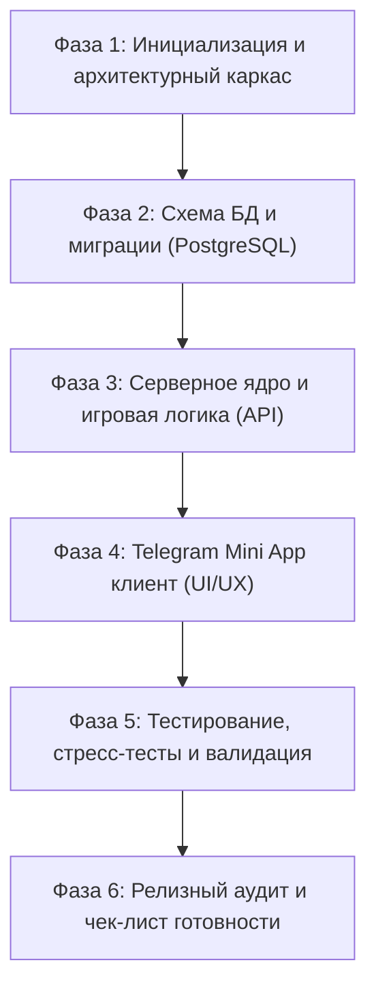
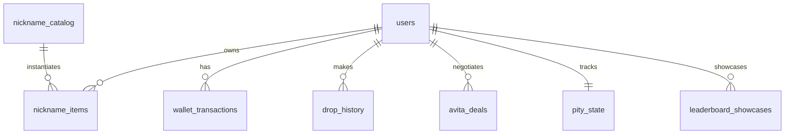

# Nickname Hunter — Мастер-спецификация и регламент разработки Telegram Mini App

## 1. Регламент и порядок работы агента (Workflow)

Разработка проекта ведётся строго последовательно по фазам. Переход к следующей фазе допускается только после успешного завершения и валидации предыдущей.

### Пошаговый алгоритм действий агента:

1. **Фаза 1: Архитектурный каркас и стек**
   - Утверждённый стек:
     - **Бэкенд:** Fastify (Node.js/TypeScript) + PostgreSQL 16 (Drizzle ORM).
     - **Авторизация:** Прямой Fastify Middleware `Authorization: tma <initData>` с проверкой HMAC-SHA256.
     - **Локальное окружение:** Docker Compose (PostgreSQL 16) + встроенный dev mock для отладки в обычном браузере.
     - **Генератор никнеймов:** Гибридный (словарь осмысленных слов + процедурные маски для коротких, чисел и симметричных никнеймов).
     - **Фронтенд:** React 19 / Vite + TypeScript + `@telegram-apps/telegram-ui` + Tailwind CSS.
     - **Интеграция TMA:** `@telegram-apps/sdk-react` и нативный `Telegram.WebApp`.

2. **Фаза 2: Проектирование и развёртывание БД**
   - Написать миграции PostgreSQL для всех 10 сущностей (`users`, `nickname_catalog`, `nickname_items`, `drop_history`, `wallet_transactions`, `pity_state`, `avita_deals`, `leaderboard_showcases`, `tasks`, `achievements`).
   - Настроить внешние ключи, уникальные составные индексы и ограничения целостности (CHECK constraints: баланс >= 0, score в диапазоне 0..1000).

3. **Фаза 3: Серверная бизнес-логика (Single Source of Truth)**
   - Реализовать криптографическую валидацию `initData` по алгоритму HMAC-SHA256 с бот-токеном.
   - Реализовать транзакционный генератор выбиваний с поддержкой Pity-счётчика и проверкой идемпотентности (`Idempotency-Key`).
   - Запрограммировать детерминированный калькулятор Nickname Score и модуль оценки/торга со скупщиком Авитой.
   - Настроить API лидерборда с кэшированием и детерминированным разрешением тай-брейков.

4. **Фаза 4: Интерфейс Telegram Mini App**
   - Настроить инициализацию TMA: `ready()`, `expand()`, обработку безопасных зон (`contentSafeAreaInset`), адаптивную тёмную палитру и тактильный отклик (`HapticFeedback`).
   - Реализовать нижнюю навигацию на 5 экранов: «Смена», «Коллекция», «Авита», «Лидерборд», «Профиль».
   - **Строго соблюдать UI-инвариант:** никнеймы выводятся исключительно чистым типографическим текстом без карточек, рамок, фонов, плашек и капсул.

5. **Фаза 5: Тестирование и верификация**
   - Написать юнит-тесты формул Nickname Score, Pity-генератора и логики торга Авиты.
   - Провести интеграционные тесты транзакций списания UD и защиты от повторных запросов (race conditions).
   - Прогнать проверку типов `tsc --noEmit` и линтеры.

6. **Фаза 6: Релизный аудит**
   - Проверить проект по финальному чек-листу (экономический баланс, обработка офлайн/ошибок, соответствие дизайну).

---

## 2. Разделение требований

### 2.1. Обязательные требования (Mandatory / MUST)

- **UI-инвариант отображения никнейма:** текст никнейма во всех разделах («Смена», «Коллекция», «Авита», «Лидерборд», «Профиль», модальные окна, генератор карточки шеринга) отображается **исключительно чистым текстом**. Категорически запрещены любые рамки, обводки, плашки, капсулы, контейнеры с фоном или скруглениями вокруг текста никнейма. Рядом разрешены только отдельные текстовые метки редкости и рейтинга.
- **Серверная авторитетность:** клиентский интерфейс является отображением состояния сервера. Запрещено доверять клиенту расчет Nickname Score, цен, балансов, исходов торга или результатов выбивания. Запрещено хранить игровой прогресс в `localStorage`.
- **Безопасность авторизации:** валидация `initData` на бэкенде через HMAC-SHA256 с проверкой `auth_date` на устаревание.
- **Транзакционность и идемпотентность:** любые операции с балансом UD и передачей предметов выполняются в `SERIALIZABLE` или `READ COMMITTED` транзакциях с блокировкой строк (`SELECT ... FOR UPDATE`). Каждое списание сопровождается уникальным ключом операции.
- **Экономические константы:**
  - Стартовый баланс нового игрока: ровно **5 000 UD**.
  - Стоимость стандартного выбивания: ровно **500 UD**.
- **Навигация:** строго 5 нижних вкладок («Смена», «Коллекция», «Авита», «Лидерборд», «Профиль»).
- **Защита витрины и избранного:** предмет, выставленный на витрину лидерборда или помеченный как избранный, программно защищён от продажи и утилизации.

### 2.2. Условные требования (Conditional / IF-THEN)

- **Нехватка средств:** *ЕСЛИ* баланс игрока < 500 UD, *ТО* кнопка «Выбить ник» блокируется, а интерфейс выводит точную сумму недостающих средств.
- **Активация Софт-пити:** *ЕСЛИ* число неудачных попыток подряд `n >= 10`, *ТО* вероятность выпадения Epic+ увеличивается по формуле с пропорциональным снижением долей Common, Uncommon и Rare до сохранения суммы 100%.
- **Активация Хард-пити:** *ЕСЛИ* число неудач достигает `n = 100`, *ТО* следующая попытка гарантированно выдаёт предмет редкости Epic, Legendary или Mythic.
- **Сброс счётчика Pity:** *ЕСЛИ* выпал предмет редкости Epic, Legendary или Mythic, *ТО* счётчик неудач в таблице `pity_state` сбрасывается в 0.
- **Ограничение торга с Авитой:** *ЕСЛИ* игрок уже выбрал один из вариантов торга (+10%, +125 UD, +50%), *ТО* повторные запросы торга в рамках данной сделки блокируются сервером.
- **Отказ Авиты в торге:** *ЕСЛИ* запрос торга отклонён, *ТО* Авита оставляет первоначальную цену либо предлагает промежуточную компромиссную сумму.
- **Отмена сделки с Авитой:** *ЕСЛИ* игрок закрывает сделку или отказывается от продажи, *ТО* предмет остаётся в коллекции игрока без изменений.
- **Приватность лидерборда:** *ЕСЛИ* игрок скрыл баланс в настройках приватности, *ТО* в публичном лидерборде его баланс заменяется плейсхолдером скрытия.
- **Тай-брейк лидерборда:** *ЕСЛИ* у нескольких игроков одинаковый Nickname Score выставленного предмета, *ТО* приоритет определяется по цепочке: Редкость (DESC) $\rightarrow$ Дата получения (ASC) $\rightarrow$ Внутренний UUID предмета (ASC).
- **Разбор дубликатов:** *ЕСЛИ* игрок инициирует разбор дубликата, *ТО* система требует явного подтверждения в модальном окне с показом точного количества фрагментов/UD.
- **Режим пониженной анимации:** *ЕСЛИ* в настройках отключены спецэффекты, *ТО* анимация прокрутки сменяется мгновенным показом результата.

---

## 3. Математические формулы и алгоритмы

### 3.1. Исправленная детерминированная формула Nickname Score

Каждый сгенерированный никнейм получает оценку $Score \in [100, 1000]$:

$$\mathbf{Score} = \operatorname{round}(0{,}20 \cdot L + 0{,}25 \cdot R + 0{,}20 \cdot M + 0{,}15 \cdot P + 0{,}10 \cdot U + 0{,}10 \cdot T)$$

Все компоненты строго нормированы в диапазоне $[0, 1000]$. Сумма весов: $0{,}20 + 0{,}25 + 0{,}20 + 0{,}15 + 0{,}10 + 0{,}10 = 1{,}00$.

| Компонент | Название | Вес | Алгоритм расчета |
| :--- | :--- | :---: | :--- |
| **$L$** | Оценка длины | 0,20 | Таблица длины никнейма (без `@`): 1 символ $\rightarrow$ 1000 2 символа $\rightarrow$ 950 3 символа $\rightarrow$ 900 4 символа $\rightarrow$ 800 5 символов $\rightarrow$ 700 6–7 символов $\rightarrow$ 600 8–10 символов $\rightarrow$ 450 11+ символов $\rightarrow$ 300 |
| **$R$** | Оценка редкости | 0,25 | Базовая шкала тира редкости: Обычный $\rightarrow$ 100 Необычный $\rightarrow$ 250 Редкий $\rightarrow$ 450 Эпический $\rightarrow$ 650 Легендарный $\rightarrow$ 850 Мифический $\rightarrow$ 1000 |
| **$M$** | Читаемость и запоминаемость | 0,20 | - Словарное слово из каталога: 1000 - Фонетически благозвучное (CVCV/VCVC): 750 - Числовой красивый код (`777`, `2020`): 700 - Буквенно-цифровое читаемое (`v1p`, `k0d`): 500 - Труднопроизносимое сочетание (`z9q`, `q7x`): 250 |
| **$P$** | Симметрия и паттерны | 0,15 | - Моно-символ (`aaa`, `xxxx`, `777`): 1000 - Палиндром/зеркало (`xox`, `aba`, `707`): 850 - Арифметическая лесенка (`123`, `abc`): 750 - Чередующийся паттерн (`abab`, `x0x`): 600 - Без паттерна: 150 |
| **$U$** | Уникальность символов | 0,10 | - Моно-алфавит (1 уникальный символ): 1000 - Алфавит из 2 уникальных символов: 700 - Редкие буквы (`x`, `z`, `q`, `v`): +200 за каждую (до 1000) - Стандартный набор символов: 350 |
| **$T$** | Спецпризнаки (Traits) | 0,10 | $T = \min\left(1000, \sum \text{trait\_weight}_i\right)$ Сумма очков коллекционных тегов предмета (*Genesis*: 400, *Symmetrical*: 250, *Number-God*: 200, *Shorty*: 200). При отсутствии тегов: 100 |

### 3.2. Система вероятностей и Pity System

**Базовые вероятности (при $n < 10$):**
- Обычный: **55,0%**
- Необычный: **25,0%**
- Редкий: **13,0%**
- Эпический: **5,5%**
- Легендарный: **1,3%**
- Мифический: **0,2%**
*(Сумма базовой группы Epic+ составляет ровно 7,0%)*

**Формула защиты от невезения (Soft Pity при $10 \le n < 100$):**

$$P(\text{Epic+}) = \min(20\%,\; 7\% + 0{,}5\% \times (n - 9))$$

При повышении $P(\text{Epic+})$ вероятности внутри группы Epic, Legendary, Mythic масштабируются пропорционально их базовым долям $(5{,}5 : 1{,}3 : 0{,}2)$. Оставшаяся вероятность $(100\% - P(\text{Epic+}))$ пропорционально распределяется между Обычным, Необычным и Редким тирами $(55 : 25 : 13)$.

**Hard Pity:** При $n = 100$ вероятность получения Epic+ устанавливается в **100%**.

### 3.3. Формула оценки и торга со скупщиком Авитой

Пусть $B$ — базовая стоимость предмета по редкости (Common: 100, Uncommon: 200, Rare: 450, Epic: 1 200, Legendary: 3 500, Mythic: 12 000 UD), $S$ — Nickname Score, а $K \in [0, 5]$ — количество специальных признаков предмета.

**Первоначальное предложение Авиты ($P$):**

$$P = \operatorname{round}\left(B \times \left(0{,}75 + 0{,}50 \times \frac{S}{1000}\right) \times (1 + \min(0{,}15,\; 0{,}03 \times K))\right)$$

**Механика торга (Действия игрока):**
1. Принять цену: сделка завершается за $P$ UD.
2. Запрос $+10\%$: запрашиваемая прибавка $\Delta = 0{,}10 \times P$.
3. Запрос $+125\text{ UD}$: запрашиваемая прибавка $\Delta = 125$.
4. Запрос $+50\%$: запрашиваемая прибавка $\Delta = 0{,}50 \times P$.

**Вероятность согласия Авиты:**

$$P(\text{согласие}) = \operatorname{clamp}\left(0{,}90 - 1{,}00 \times \frac{\Delta}{P},\; 0{,}05,\; 0{,}85\right)$$

- При отказе Авита с вероятностью 60% оставляет исходную цену $P$, а с вероятностью 40% предлагает компромиссную цену $P_{\text{comp}} = \operatorname{round}(P + 0{,}4 \times \Delta)$.

---

## 4. Архитектура базы данных (PostgreSQL)

### Схема ключевых таблиц

1. **`users`**
   - `id`: UUID (PK)
   - `telegram_id`: BIGINT (UNIQUE, NOT NULL)
   - `username`: VARCHAR(64)
   - `balance_ud`: BIGINT (NOT NULL DEFAULT 5000, CHECK balance_ud >= 0)
   - `level`: INT (DEFAULT 1), `xp`: INT (DEFAULT 0)
   - `privacy_hide_balance`: BOOLEAN (DEFAULT FALSE)
   - `created_at`, `updated_at`: TIMESTAMPTZ

2. **`nickname_catalog`**
   - `id`: SERIAL (PK)
   - `nickname`: VARCHAR(32) (UNIQUE, NOT NULL)
   - `category`: VARCHAR(32) NOT NULL
   - `base_memorability`: INT NOT NULL
   - `base_pattern`: INT NOT NULL
   - `default_traits`: JSONB

3. **`nickname_items`**
   - `id`: UUID (PK)
   - `owner_id`: UUID (FK -> users.id, NULL если сожжён/продан)
   - `nickname`: VARCHAR(32) NOT NULL
   - `rarity`: VARCHAR(16) NOT NULL
   - `score`: INT NOT NULL (CHECK score >= 0 AND score <= 1000)
   - `traits`: JSONB NOT NULL DEFAULT '[]'
   - `is_favorite`: BOOLEAN DEFAULT FALSE
   - `is_locked`: BOOLEAN DEFAULT FALSE
   - `dropped_at`: TIMESTAMPTZ NOT NULL DEFAULT NOW()

4. **`pity_state`**
   - `user_id`: UUID (PK, FK -> users.id)
   - `counter`: INT NOT NULL DEFAULT 0 (CHECK counter >= 0)
   - `last_updated`: TIMESTAMPTZ DEFAULT NOW()

5. **`avita_deals`**
   - `id`: UUID (PK)
   - `user_id`: UUID (FK -> users.id)
   - `item_id`: UUID (FK -> nickname_items.id)
   - `initial_price`: INT NOT NULL
   - `action_type`: VARCHAR(16)
   - `requested_price`: INT
   - `final_price`: INT
   - `status`: VARCHAR(16) NOT NULL -- 'PENDING', 'ACCEPTED', 'REJECTED', 'CANCELLED'
   - `created_at`, `closed_at`: TIMESTAMPTZ

6. **`leaderboard_showcases`**
   - `user_id`: UUID (PK, FK -> users.id)
   - `item_id`: UUID (FK -> nickname_items.id, UNIQUE)
   - `updated_at`: TIMESTAMPTZ DEFAULT NOW()

---

## 5. Архитектура и компоненты Telegram Mini App

- **Полноэкранный режим и Safe Area:** Использование `--tg-safe-area-inset-top` и `--tg-safe-area-inset-bottom` для исключения перекрытия нативного бара Telegram.
- **Тактильная отдача (Haptic Feedback):**
  - Выбивание предмета: `impactOccurred('heavy')` при показе легендарного/мифического, `impactOccurred('medium')` для остальных.
  - Нажатие кнопок навигации: `selectionChanged()`.
  - Успешная продажа у Авиты: `notificationOccurred('success')`.
- **Генератор шеринга «Поделиться находкой»:**
  - Формирование PNG через HTML Canvas / SVG без внешних графических библиотек.
  - Никнейм рендерится чистым шрифтом (Inter/Roboto Mono) по центру, без обрамляющих рамок и карточек.
  - Экспорт в `Telegram.WebApp.shareToStory` или прямая пересылка ссылки с preview-параметрами.
